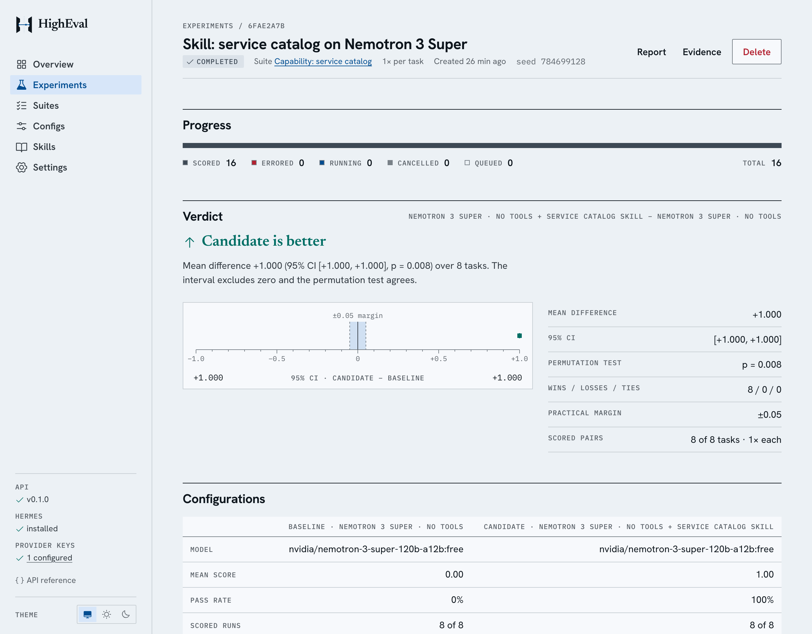
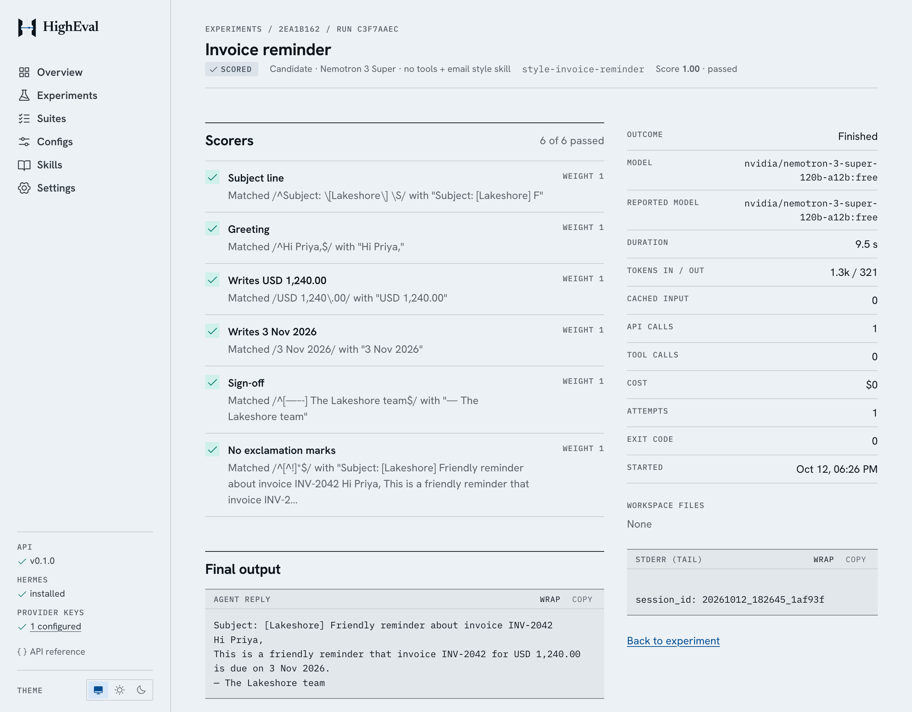
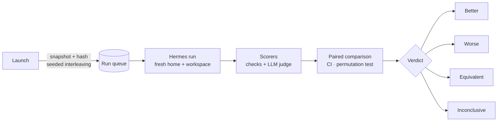

<p align="center">
  
</p>

<h1 align="center">HighEval</h1>

<p align="center">
  <strong>A/B evaluations for <a href="https://github.com/NousResearch/hermes-agent">Hermes Agent</a>.</strong><br />
  Change the model, skills, memory or tools, and find out whether the agent got better, worse, or stayed the same, with evidence.
</p>

<p align="center">
  <a href="https://github.com/SahilChoudhary22/higheval/actions/workflows/ci.yml"></a>
  
  
  
  <a href="LICENSE"></a>
</p>

<p align="center">
  <a href="#quick-start">Quick start</a> ·
  <a href="#results">Results</a> ·
  <a href="docs/design.md">Design</a> ·
  <a href="docs/limitations.md">Limitations</a> ·
  <a href="docs/costs.md">Costs</a> ·
  <a href="#api">API</a>
</p>

<p align="center">
  
</p>

HighEval runs the same task suite under two Hermes configurations, scores every run, and reports the paired difference with a 95% confidence interval and a verdict from a rule fixed before the data. It never calls a difference real when the evidence can't support it, and every run can be opened to see exactly why it passed or failed.

## Features

- **Tasks and scoring.** Suites of tasks with fixture files and typed scorers: JSON fields with tolerances, regular expressions, files created, tools used, and a pinned LLM judge for conversational quality. Every scorer explains its result, and hard rules can be marked `required`.
- **Draft suites with HighEval AI.** Describe what to test in plain language. HighEval AI, an agent built on Hermes, writes the tasks, fixtures and scorers, computes expected values with a script, and HighEval checks the draft against the schema and the agent's own reference answers before you review it.
- **Configurations.** Provider and model, skills, Hermes' built-in skills, memory (off or seeded), toolsets and limits, snapshotted and hashed at launch so edits never rewrite history.
- **Isolated, durable runs.** Every run gets a fresh Hermes home, workspace and environment. Runs are interleaved in a seeded random order, with retries, cancellation, hard timeouts and restart recovery.
- **Statistics you can defend.** Paired per-task differences, a seeded 95% bootstrap interval, an exact sign-flip permutation test, and an explicit equivalence margin.
- **Run inspector.** Scorer results, the final reply, the tool-call timeline, workspace files, tokens, API calls and cost for every run.
- **Seven providers.** OpenRouter, OpenAI, Anthropic, Google AI Studio, DeepSeek, xAI and NVIDIA NIM, with keys managed in the app.
- **Typed API.** Every endpoint is described by an OpenAPI 3.1 document generated from the same Zod schemas that validate it.

<p align="center">
  
  <br /><sub>One run opened in the inspector: every check passed, each with the evidence it matched.</sub>
</p>

## Quick start

**Prerequisites:**

- macOS or Linux (Windows through WSL2 is untested)
- [Node.js](https://nodejs.org) 22.18+ with Corepack (`corepack enable pnpm`)
- [uv](https://docs.astral.sh/uv/) and git
- An [OpenRouter](https://openrouter.ai) API key

```bash
git clone https://github.com/SahilChoudhary22/higheval.git
cd higheval
pnpm start
```

One command does the setup. It:

1. Checks prerequisites.
2. Creates `.env` on first run.
3. Installs dependencies.
4. Installs the pinned Hermes runtime into `./.hermes-runtime`. This happens once, takes about a minute and about 1.3 GB, and leaves your home directory untouched.
5. Serves the app at **http://127.0.0.1:3000**.

Open **Settings** and paste your OpenRouter key; it's verified with the provider before it's saved. The database is seeded with sample suites, skills and configurations, including pairs that differ in one setting (a skill, memory or tools), so you can launch an experiment right away.

### Try it in a minute

**Launch experiment**, then choose:

| Field       | Choose                                                  |
| ----------- | ------------------------------------------------------- |
| Suite       | **Capability: service catalog**                         |
| Baseline    | **Nemotron 3 Super · no tools**                         |
| Candidate   | **Nemotron 3 Super · no tools + service catalog skill** |
| Repetitions | **1**                                                   |

The 16 runs finish in about 30 seconds on a free model, and the verdict should be _Candidate is better_: the skill holds pricing rules the model cannot know. Open a baseline run in the inspector to see what the model said without it. The other capability suites work the same way with the memory, email style and file-tools configurations.

A full experiment takes longer because nearly all the time is spent waiting on the model. Each run makes 3–5 calls, and free endpoints take about 10 s per call, so plan on roughly _runs × 40 s ÷ concurrency_. The 96-run model-change experiment took 22 minutes at concurrency 3. The launch form shows this estimate before you start.

Free-model request limits depend on your OpenRouter account: a Quick check uses about 30 requests and a 96-run experiment about 360.

### Draft a suite with HighEval AI

Go to **Suites → Draft with HighEval AI** and describe what to test, for example:

> Three tasks for a dental clinic front desk: find double-booked appointments (back-to-back slots are fine), compute no-show fees with a 24-hour grace period, and list patients due for a six-month check-up.

HighEval AI is a Hermes agent. It works in an isolated workspace, like any experiment run, with:

- the suite's JSON Schema
- two known-good example tasks
- an authoring skill

It writes the suite and a reference solution for each task. HighEval then requires every deterministic scorer to pass against that reference, and sends any problems back for another attempt. The draft opens in the editor for you to review; nothing is saved until you save it. You can follow up with changes ("make the second task stricter"), and it revises the draft. See [design decision 10](docs/design.md#10-hermes-drafts-suites-higheval-checks-them).

## How it works



The verdict is fixed before any data comes in:

| Verdict         | Requires                                                                                                                         |
| --------------- | -------------------------------------------------------------------------------------------------------------------------------- |
| Better or worse | The 95% interval excludes zero **and** the exact permutation test agrees (p ≤ 0.05).                                             |
| Equivalent      | The interval lies inside the practical margin **and** the suite has enough tasks to rule out a hidden difference (≥ 3 ÷ margin). |
| Not enough data | Fewer than 5 paired tasks.                                                                                                       |
| Inconclusive    | Anything else.                                                                                                                   |

[docs/design.md](docs/design.md) covers the architecture, the isolation guarantees (and the live test that proves them), failure classification, and the alternatives considered.

## Sample suites

| Suite                                                                          | Tasks | What it tests                                                                                                                                                                                                       |
| ------------------------------------------------------------------------------ | ----: | ------------------------------------------------------------------------------------------------------------------------------------------------------------------------------------------------------------------- |
| [Agency operations](apps/api/src/samples/agency-ops-suite.ts)                  |    16 | Back-office work for a marketing agency: billing, CRM hygiene, scheduling, compliance and reporting, with deliberate edge cases (boundary dates, time zones, partial payments, tiered thresholds)                   |
| [Quick check](apps/api/src/samples/quick-check-suite.ts)                       |     5 | A fast subset of Agency operations, for demos                                                                                                                                                                       |
| [Customer conversations](apps/api/src/samples/customer-conversations-suite.ts) |     3 | Customer replies. Hard rules (states the refund window, quotes no prices, fits in one SMS) are `required` checks; empathy, accuracy and a clear next step are rated by a pinned judge from a different model family |
| [Capability suites](apps/api/src/samples/capability-suites.ts)                 | 4 × 8 | Service catalog, email house style, client memory and reading files: each answerable only with one setting (a skill, seeded memory or file tools), with matching configurations to switch it on and off             |

Every deterministic task has a reference solution that must score 1.0 in CI. Expected answers live only in the scorers and are never written into the agent's workspace.

## Results

Six real experiments, all on free models.

**Capability experiments** ([report](docs/experiments/capabilities.md)) change one setting on the same model (Nemotron 3 Super), on 8-task suites that only that setting makes answerable. Each takes about 30 seconds, and each reaches a conclusive verdict:

| Change                                                        | Verdict    | Mean difference, 95% CI            | Wins / losses |
| ------------------------------------------------------------- | ---------- | ---------------------------------- | ------------- |
| + a skill with the agency's service catalog and pricing rules | **Better** | +1.000 [+1.000, +1.000], p = 0.008 | 8 / 0         |
| + a skill with the agency's email house style                 | **Better** | +0.738 [+0.675, +0.800], p = 0.008 | 8 / 0         |
| Memory off → seeded with client facts                         | **Better** | +1.000 [+1.000, +1.000], p = 0.008 | 8 / 0         |
| File tools removed                                            | **Worse**  | −0.938 [−1.000, −0.813], p = 0.008 | 0 / 8         |

**Realistic experiments** on the 16-task Agency operations suite, where the changes were subtler:

| Experiment                                       | Change                                             | Runs | Verdict                                           | Takeaway                                                                                  |
| ------------------------------------------------ | -------------------------------------------------- | ---: | ------------------------------------------------- | ----------------------------------------------------------------------------------------- |
| [Model change](docs/experiments/model-change.md) | Nemotron 3 Super → Nemotron 3.5 Lightning          |   96 | Inconclusive<br/>Δ −0.104, 95% CI [−0.229, 0.000] | Lightning won no task, lost 3, and was 2× slower. Don't switch on this evidence.          |
| [Skill change](docs/experiments/skill-change.md) | Lightning without → with a generic checklist skill |   64 | Inconclusive<br/>Δ −0.030, 95% CI [−0.083, 0.000] | The skill changed behaviour (more output checks) but not outcomes, and added 25% latency. |

Together they show both halves of the job: a skill that carries knowledge or a procedure the model lacks produces a clear, conclusive improvement, while a generic "be careful" checklist does not, and HighEval says so instead of overclaiming.

Each report was generated by the platform from stored results (`GET /api/experiments/:id/report.md`), then extended with an analysis that traces failures through the run inspector. The full JSON evidence for each ships next to its report.

## API

The web app is a client of a documented REST API:

|                           |                                                                        |
| ------------------------- | ---------------------------------------------------------------------- |
| **Interactive reference** | **http://127.0.0.1:3000/api/docs**, also linked from the app's sidebar |
| **OpenAPI 3.1 document**  | `GET /api/openapi.json`                                                |

The document is generated at startup from the running controllers and the shared Zod schemas, so it always matches what the server validates. A test fails if any route is undocumented. Validation errors return field-level `issues`:

```bash
curl -s -X POST http://127.0.0.1:3000/api/experiments \
  -H 'Content-Type: application/json' -d '{"name": "x"}'
# {"message":"Validation failed","issues":[{"path":"suiteId","message":"Required"}, …]}
```

## Configuration

Every setting is optional and validated at startup; the app refuses to boot on an invalid value. Provider keys can also be managed in **Settings**, where a saved key overrides `.env`.

| Variable                                 | Default                                                 | Purpose                                                                                           |
| ---------------------------------------- | ------------------------------------------------------- | ------------------------------------------------------------------------------------------------- |
| `OPENROUTER_API_KEY`                     | —                                                       | OpenRouter key, used by the sample configurations, the LLM judge and the suite assistant          |
| `<PROVIDER>_API_KEY`                     | —                                                       | Keys for other providers: `OPENAI`, `ANTHROPIC`, `GEMINI`, `DEEPSEEK`, `XAI`, `NVIDIA`            |
| `HOST` / `PORT`                          | `127.0.0.1` / `3000`                                    | Bind address. Any address other than loopback requires `AUTH_USERNAME` and `AUTH_PASSWORD`        |
| `AUTH_USERNAME` / `AUTH_PASSWORD`        | —                                                       | Require sign-in for the UI and API (hosted deployments)                                           |
| `SESSION_SECRET`                         | random per start                                        | Signs session cookies; set it (32+ characters) so sign-ins survive restarts                       |
| `PROVIDER_KEYS_READ_ONLY`                | `false`                                                 | Make Settings test-only, so visitors to a hosted demo cannot change keys                          |
| `ALLOWED_HOSTS`                          | —                                                       | Extra hostnames the API answers to (for example a tunnel's public name); other hosts are rejected |
| `DATA_DIR`                               | `./data`                                                | SQLite database and per-run artifacts                                                             |
| `MAX_CONCURRENT_RUNS`                    | `4`                                                     | Parallel agent runs across all experiments                                                        |
| `MAX_RUN_ATTEMPTS`                       | `3`                                                     | Attempts for retryable failures (rate limits, restarts)                                           |
| `RETRY_BASE_DELAY_MS`                    | `15000`                                                 | First retry delay for runs; doubles each attempt                                                  |
| `JUDGE_RETRY_BASE_DELAY_MS`              | `2000`                                                  | First retry delay for rate-limited judge calls; doubles each attempt                              |
| `ASSISTANT_PROVIDER` / `ASSISTANT_MODEL` | `openrouter` / `nvidia/nemotron-3-super-120b-a12b:free` | Model the suite assistant drafts with                                                             |
| `SEED_SAMPLES`                           | `true`                                                  | Seed the sample definitions into an empty database                                                |
| `HERMES_MANIFEST`                        | `.hermes-runtime/manifest.json`                         | Where the Hermes setup script records the installed runtime                                       |
| `LOG_FORMAT`                             | `pretty`                                                | `json` for structured logs                                                                        |

## Hosting

The repository includes a Docker image and a Compose file for running HighEval on a server:

```bash
cp .env.example .env    # set OPENROUTER_API_KEY, AUTH_USERNAME, AUTH_PASSWORD, SESSION_SECRET and ALLOWED_HOSTS
docker compose up -d --build
```

Then point a tunnel (for example Cloudflare Tunnel or Tailscale Funnel) or an HTTPS reverse proxy at `http://127.0.0.1:3000`, and add its public hostname to `ALLOWED_HOSTS`.

What protects a hosted instance:

- **Agents are confined to the container.** Their tools can run commands, so the container runs as an unprivileged user with no Linux capabilities, and the host never sees its files.
- **Every page and API route needs a login.** Login is required whenever the app listens beyond loopback; it uses signed, HttpOnly session cookies and limits failed attempts.
- **Keys can be locked.** `PROVIDER_KEYS_READ_ONLY=true` stops visitors changing the provider keys you configured.

## Development

```bash
pnpm install
pnpm setup:hermes   # once
pnpm dev            # API on :3000 (watch), web on :5173 with /api proxied
```

| Command                                 | What it does                                                                              |
| --------------------------------------- | ----------------------------------------------------------------------------------------- |
| `pnpm check`                            | Format check, type-aware lint, typecheck, unit tests and build: what CI runs              |
| `pnpm --filter @higheval/api test:cov`  | Unit and e2e tests with coverage thresholds (about 92% of lines)                          |
| `pnpm --filter @higheval/api test:e2e`  | The API over HTTP, with a deterministic fake executor                                     |
| `pnpm --filter @higheval/api test:live` | Real Hermes and a real model: proves tool, skill and memory isolation (about 10 requests) |

### Engineering practices

- **Tooling:** strict TypeScript; oxlint (type-aware) plus ESLint for Vue; Prettier.
- **Commits and CI:** Conventional Commits, enforced by a commit hook. CI runs on every push to `main` and on every pull request.
- **Supply chain:** dependencies may not run install scripts unless allowlisted, and new releases must age before pnpm installs them.

### Repository layout

```
apps/api          NestJS API: definitions, experiment runner, Hermes executor, scoring,
                  statistics, suite assistant, provider keys, OpenAPI
apps/web          Vue 3 single-page app
packages/shared   Zod schemas: the API contract shared by both apps
scripts/          start.sh (one-command start), setup-hermes.sh (pinned runtime)
docs/             design, limitations, costs, experiment reports
```

## Documentation

| Document                           | Contents                                                                                               |
| ---------------------------------- | ------------------------------------------------------------------------------------------------------ |
| [Design](docs/design.md)           | Architecture, key decisions and the alternatives considered, data model, assumptions, testing strategy |
| [Limitations](docs/limitations.md) | Known limits of the evidence, the execution environment and the product                                |
| [Costs](docs/costs.md)             | Measured and estimated costs of models, compute, hosting and people's time                             |
| [Experiments](docs/experiments)    | Reports and raw evidence from the real experiments                                                     |

## Roadmap

- **MCP server:** expose suites, experiments and verdicts as tools, so an agent (Hermes included) can run its own evaluations.
- **Sandboxing:** run each agent in a container through Hermes' Docker terminal backend, for untrusted agents and tasks.
- **Pairwise judging, calibrated against human labels, and multi-turn conversations** (designed in [docs/design.md](docs/design.md#evaluating-conversational-agents)).
- **Scale-out:** a worker queue, Postgres and live progress over server-sent events.

## License

[MIT](LICENSE)
