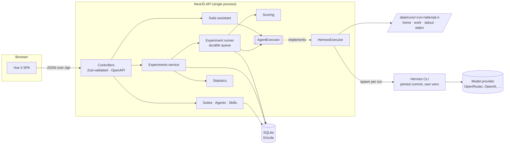
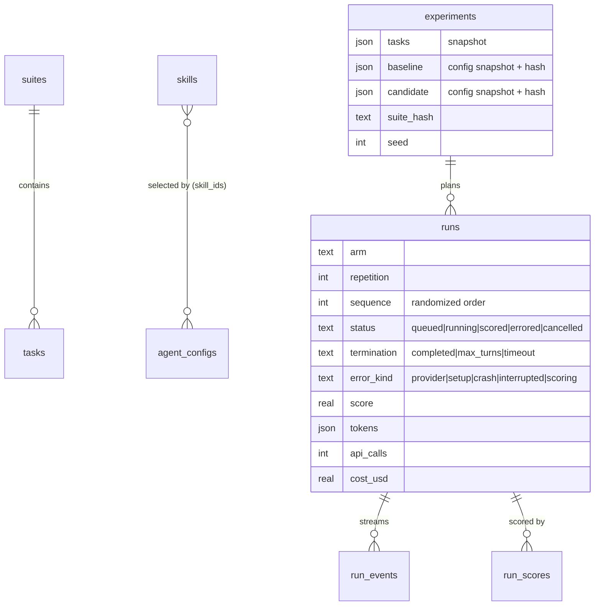

# HighEval design

HighEval answers one question with evidence: **after changing an agent's model, skills, memory or tools, did it get better, worse, or stay the same?** It runs the same task suite under two [Hermes Agent](https://github.com/NousResearch/hermes-agent) configurations, scores every run with deterministic checks (and a pinned LLM judge where a task needs one), and reports a paired comparison with an uncertainty interval and a pre-registered decision rule.

This document covers the architecture, the main decisions and the alternatives considered. Known limits are in [limitations.md](limitations.md) and running costs in [costs.md](costs.md).

## Architecture

| Package           | Responsibility                                                                                                                                                                                                                                                                                           |
| ----------------- | -------------------------------------------------------------------------------------------------------------------------------------------------------------------------------------------------------------------------------------------------------------------------------------------------------- |
| `packages/shared` | Zod schemas for every request and response. The API validates input with them; the web app validates every response with them. One source of truth for the contract.                                                                                                                                     |
| `apps/api`        | NestJS modules: `suites`, `skills`, `configs`, `experiments` (service, runner, run inspection), `execution` (executor interface + Hermes implementation), `scoring` (scorers + LLM judge), `statistics`, `assistant` (suite drafting), `providers` (keys), `openapi`, `samples` (seed data), `database`. |
| `apps/web`        | Vue 3 SPA: overview, experiment launch and detail, run inspector, suite/config/skill editors with the suite assistant, provider settings.                                                                                                                                                                |

### Request lifecycle of an experiment

1. **Launch** (`POST /api/experiments`). The service snapshots the suite's tasks and both configurations, inlining skill contents, and hashes everything that can change behaviour. It then creates every run up front (`tasks × 2 arms × repetitions`) in a **seeded random order**, so both arms are interleaved over time.
2. **Execute.** The runner claims queued runs in a SQLite transaction, up to a global concurrency limit, and hands each to the `AgentExecutor`. Normalized events (`session`, `text`, `tool_call`, `tool_result`, `error`) are persisted as they stream in.
3. **Score.** When a run completes, its scorers read the final reply, files in the run's workspace, and the tool-call trace. Each scorer stores a pass/fail, a 0–1 score and a human-readable reason.
4. **Compare** (`GET /api/experiments/:id/comparison`). Computed on read from the stored runs, so it is always consistent with the evidence.
5. **Inspect** (`GET /api/runs/:id`). Prompt, final output, scorer reasons, event timeline, workspace files, tokens, API calls, cost and stderr.

## Key decisions

### 1. Hermes is invoked as a CLI subprocess, behind an interface

The platform must be TypeScript, and Hermes is Python. The options were a Python sidecar service, embedding Hermes as a library through a bridge, or spawning its CLI. The CLI's `--format stream-json` mode already emits structured events (session, text deltas, tool calls and results, a final token envelope), so a subprocess needs no authored Python and no long-lived state.

- `AgentExecutor` is an abstract class. Scoring, storage and statistics consume only its normalized outcome, so another agent runtime could be added without touching them. The e2e tests use a deterministic fake executor through this seam.
- Processes are spawned **with an argument array, never a shell**, in their own process group. Cancellation and hard timeouts send SIGTERM and then SIGKILL to the whole group, so tools the agent started die with it.
- Hermes is installed from a **pinned commit** into `./.hermes-runtime` by `scripts/setup-hermes.sh`, which skips the browser and computer-use extras. The API calls the installed interpreter directly, avoiding a wrapper that re-verified dependencies on every call (15–20 s each).

### 2. Every run starts from a clean, separate environment, and the separation is tested

A comparison is only meaningful if the two arms differ **only** in the configuration under test. Isolation here means _no unrecorded differences_, not a stripped-down agent: anything that reaches the agent must come from the configuration and be captured in its snapshot and hash. Reading the Hermes source turned up several ways state could leak between runs or arms. Each run gets a fresh `HERMES_HOME`, a throwaway `HOME`, and a fresh working directory, and the generated `config.yaml` pins the following:

| Leak                                                                                                                                      | Mitigation                                                                                                                                                                                                                                           |
| ----------------------------------------------------------------------------------------------------------------------------------------- | ---------------------------------------------------------------------------------------------------------------------------------------------------------------------------------------------------------------------------------------------------- |
| Hermes copies its 58 bundled skills into every new home and lists them in the prompt                                                      | `HERMES_BUNDLED_SKILLS` points at a non-existent directory, so Hermes seeds nothing itself. HighEval writes the configuration's own skills (preloaded with `--skills`) and copies only the built-in skills it selects, which are recorded and hashed |
| "Coding context" walks up from the working directory, finds this repo's `package.json`, and injects git state and scripts into the prompt | `agent.coding_context: off`, plus `git init` in each workspace so context-file discovery stops there                                                                                                                                                 |
| OpenRouter response caching is on by default, so a repetition could be served the previous reply                                          | `openrouter.response_cache: false`                                                                                                                                                                                                                   |
| Silent model fallback                                                                                                                     | `fallback_providers: []`; the model Hermes actually used is read back from its session database and shown next to the requested one                                                                                                                  |
| Memory and background learning                                                                                                            | Built-in memory, user profile, memory providers, background review, title generation and the curator are all disabled; "seeded" memory writes only the configured entries                                                                            |
| Host side effects (`~/.local/bin` publication, lazy package installs, update checks)                                                      | `cli.expose_on_path: false`, `HERMES_DISABLE_LAZY_INSTALLS=1`, `updates.check: false`, fake `HOME`                                                                                                                                                   |
| Inherited secrets                                                                                                                         | The child environment is built from scratch: `PATH`, locale, Hermes paths and the run's own provider key only                                                                                                                                        |

**Built-in skills are a recorded dimension, off by default.** A normal Hermes install gives the agent all 58 bundled skills: an index of them in the system prompt, with full bodies loaded on demand. Silently dropping them would make HighEval measure an agent nobody runs; silently keeping them would leave a large, unrecorded input in every run. So each configuration chooses `none` (the default, and what every existing configuration and experiment used), `all`, or a named selection from `GET /api/hermes/skills`, which reads the pinned checkout. When an experiment launches, the selection is resolved into exact paths (skill directories plus their category descriptions) and the snapshot records the skill names, a SHA-256 over the copied files and the Hermes commit. All three feed the behaviour hash. The mode does not, because `all` and selecting every skill give the agent the same files. The executor copies exactly those paths and refuses to run a snapshot taken on a different Hermes commit.

Hermes only indexes skills for an agent that has its skill tools (`skills_list`, `skill_view`), so files copied without them would have no effect. Selecting built-in skills therefore also enables the `skills` toolset, and the editor shows it as on. Hermes treats each run as one-shot, so `skill_manage` is withheld and the agent cannot write skills. Skills limited to another operating system, or that need a toolset the configuration lacks (for example `maps` needs `terminal`), are copied but left out of the index by Hermes.

`test:live` checks these claims against the real runtime and a real model:

- a selected skill's instruction is visible only to the configuration that selects it
- a selected built-in skill appears in the skills index and other bundled skills do not
- a seeded memory fact is recalled only when memory is seeded
- "no tools" produces no tool calls
- the stored system prompt contains no host project context and, without built-in skills, no skills index

Expected answers live only in scorer definitions in the database, never in the files given to the agent; a unit test enforces this for the sample suite.

**What this does not cover.** Hermes' `file` and `terminal` tools accept absolute paths and run as the user who started HighEval, so an agent _could_ deliberately read outside its workspace: other runs' workspaces, or the SQLite database holding the scorers. No run in the reported experiments did so (the inspector records every tool call and path), but it is a threat to validity for untrusted agents. The fix is to run Hermes in a container; see [limitations.md](limitations.md).

### Agent files

Hermes builds an agent's character from a few files, and each is an agent setting in HighEval:

- `SOUL.md` in the Hermes home is the agent's identity and the first thing in its system prompt. Without one, Hermes writes its built-in persona.
- `memories/MEMORY.md` and `memories/USER.md` hold the agent's notes and what it knows about its user, as `§`-separated entries loaded once at the start of a session.
- `AGENTS.md` in the working directory holds standing instructions, which Hermes loads as project context.

Each run gets exactly the agent's files, and their contents are part of the snapshot hash. A live test checks that a custom persona replaces Hermes' own and that the instructions and user profile reach the system prompt. A task fixture named like a project-instruction file (`AGENTS.md`, `.hermes.md`, `CLAUDE.md`, `.cursorrules`) would hide the agent's `AGENTS.md`, so such a launch is refused. Memory is seeded, never written: runs do not expose Hermes' `memory` or `session_search` tools and background review is off, so both agents start every run from the same state.

The editor imports these files from a Hermes home (`~/.hermes`) or an OpenClaw workspace, read in the browser. It follows Hermes' own OpenClaw importer: dated daily notes are merged into memory, and OpenClaw-only files (`IDENTITY.md`, `TOOLS.md`, `HEARTBEAT.md`, `BOOTSTRAP.md`) are listed but not used. Hermes keeps no dated memory itself; what it learns over time goes into the skills it writes, which is a natural next dimension (train an agent, freeze what it learned, test it).

### 3. Failures are classified, not averaged away

Runs end in one of two classes, and the distinction drives the statistics:

- **Scored**, with termination `completed`, `max_turns` or `timeout`. The agent produced something (or ran out of budget), so its output is scored. Running out of turns or time is agent behaviour and counts against it.
- **Errored**, with kind `provider`, `setup`, `crash`, `interrupted` or `scoring`. These are failures outside the agent's control (including a bug in a scorer) that say nothing about agent quality, so they are excluded from the comparison and reported as missing coverage. Rate limits (HTTP 429) are retried up to `MAX_RUN_ATTEMPTS` with jittered exponential backoff that starts at about a minute, because OpenRouter's free tier counts requests per minute. A daily quota (OpenRouter's `free-models-per-day`) is not retried, since it only resets at 00:00 UTC: the run errors at once with that explanation, and **Retry errored runs** re-queues a finished experiment's errored runs, in their seeded order, once the quota is back. Whatever goes wrong after the agent returns, a run always ends in a final state and the queue keeps moving.

The classification uses Hermes' exit contract: exit 0 means completed; exit 1 _without_ an error field means the turn did not complete, which is a turn-limit stop when the API call count reached `maxTurns`; exit 1 _with_ an error is matched against provider error patterns. `--run-budget` is only advisory in Hermes, so the executor enforces a hard wall-clock limit itself.

### 4. Statistics: paired, task-level, pre-registered

Each task is run under both arms, so the natural unit of analysis is the **paired per-task difference** (candidate − baseline).

1. Repetitions are **averaged per task and arm first**. Repeats of one task are not independent evidence about the suite, so resampling them separately would overstate confidence.
2. **95% paired bootstrap percentile interval** for the mean difference: 10,000 resamples of tasks, using a seeded PRNG so the same experiment always reports the same interval.
3. **Sign-flip permutation test** for a p-value: exact enumeration up to 16 tasks, seeded Monte Carlo above that.
4. **Decision rule**, fixed before data and shown in the UI:
   - fewer than 5 paired tasks → _not enough data_
   - interval entirely above 0 **and** permutation p ≤ 0.05 → _candidate better_; entirely below 0 and p ≤ 0.05 → _candidate worse_
   - interval entirely inside ±margin **and** at least 3/margin paired tasks (60 at ±0.05) → _practically equivalent_
   - anything else → _inconclusive_

Why both conditions? The percentile bootstrap is anti-conservative when most tasks tie, which is common with pass/fail scorers. Five tied tasks give a zero-width interval [0, 0]. Five tasks that all favour the candidate give an interval excluding zero, even though the exact permutation p-value cannot go below 0.0625 at n = 5. Requiring the exact test to agree removes the first problem. The equivalence floor comes from the "rule of three": with no discordant task among n, up to about 3/n of tasks could still differ unseen, and each can move the mean by up to 1/n.

An interval that merely contains zero is never reported as "no difference". Equivalence needs an explicit practical margin, chosen when the experiment is launched. A judge's self-reported confidence or a raw score gap is not used as confidence.

With 16 tasks the interval should still be read as approximate. See [limitations.md](limitations.md).

### 5. Experiments are immutable snapshots

Editing a suite or configuration after launch must not change what an experiment measured. Each experiment stores:

- the full task list
- both configuration snapshots, with skill contents inlined, built-in skills resolved to names, paths and a content hash, and the Hermes commit
- a SHA-256 of the task definitions and of each configuration's behaviour-affecting fields
- the PRNG seed used for both run order and resampling

Every number on the results page can therefore be traced to exact inputs.

### 6. Durable, restart-safe execution in one process

There is no external queue. All execution state lives in SQLite:

- Runs are claimed transactionally.
- Retry backoff is stored as `not_before`, so it survives restarts.
- On boot, runs left `running` are re-queued if attempts remain, or marked `interrupted` if not.
- Shutdown aborts in-flight processes.

This was exercised in practice: restarting the API mid-experiment recovered the in-flight runs, with no orphaned Hermes processes. The trade-off is single-node execution, which is fine for a local tool and noted in the limitations.

### 7. Deterministic checks gate; a pinned LLM judge rates quality

Scorers are typed and declarative:

- `contains`
- `regex`
- `json_valid`
- `json_field`, with numeric tolerance and order-insensitive arrays
- `file_exists`
- `tool_called`, with min/max bounds
- `llm_judge`, a pinned judge model rating the reply against a rubric

They can target the final reply or any file in the workspace. JSON is extracted leniently from replies (whole text, then fenced blocks, then balanced objects, preferring the last of each so a final answer beats an earlier draft or example), so tasks measure correctness rather than formatting habits. Expected objects can require `exact` keys, unordered arrays use a proper matching rather than greedy pairing, numeric strings must be plain decimals, and regex patterns with nested quantifiers (a ReDoS risk) are rejected when a suite is saved.

Every result carries a reason ("Field `overdue_total` = 5800.5 (±0.01)"), which is what makes the run inspector useful.

**Conversational replies need both kinds of scoring.** Hard requirements of a reply (states the refund window, quotes no prices, fits in one SMS) are deterministic checks marked `required`: if one fails, the task fails whatever its weighted score, so quality points cannot buy back a broken rule. Quality (empathy, accuracy to policy, a clear next step) is rated by an `llm_judge` scorer:

- **Pinned and recorded.** The judge model, rubric and criteria live inside the scorer, so they are part of the suite hash; changing any of them changes the experiment's fingerprint.
- **Independent.** Launch is refused if the judge is one of the models under test, to avoid a model grading its own output. The sample suite's judge (Cohere North Mini) is also from a different model family than the two NVIDIA Nemotron configurations it grades.
- **Deterministic settings and a structured verdict.** Temperature 0, a 1–5 rating per criterion with a one-sentence reason, parsed strictly (every criterion exactly once). The response is fenced and the judge is told to treat it as data, a basic prompt-injection guard.
- **Failures are not zeros.** An unusable verdict is retried once; after that, or on persistent rate limits, the run is recorded as a `scoring` error and excluded from the comparison rather than scored 0.
- **Costed separately.** Judge requests, tokens and cost are stored per run and reported per arm, apart from the agent's own usage.

Two things are deliberately not built yet; they are the next steps, described in [Evaluating conversational agents](#evaluating-conversational-agents) below: **pairwise judging** (show the judge both arms' replies in both orders, which is more sensitive than absolute ratings and cancels position bias), and **calibration against human labels** (until then, judge ratings are an assumption, not a measurement).

### 8. One validated contract across the stack

Zod schemas in `packages/shared` define every payload.

- The API validates bodies with a `ZodValidationPipe` and returns field-level issues.
- The web client parses every response with the same schemas, so drift between backend and frontend fails loudly instead of rendering `undefined`.
- Environment variables are validated at boot, and the app refuses to start on invalid configuration.
- The OpenAPI 3.1 document (`/api/openapi.json`, browsable at `/api/docs`) is generated from the same schemas. Each route names its request and response schemas with `@ApiDoc`, and the document is assembled at startup by discovering the running controllers, so it cannot describe a route that does not exist or miss one that does; a test fails if any route is undocumented. Shared contracts become named components, with input and output forms merged where they are identical. A hand-written spec or `@nestjs/swagger` DTO classes were the alternatives; both duplicate the Zod contract and drift from it.

### 9. Interface

The UI follows a "lab ledger" direction derived from the [Hallmark](https://github.com/Nutlope/hallmark) design guidance (Almanac theme, adapted for a dense tool):

- cool paper background, a single ink-blue accent, hairline rules instead of cards
- tabular figures throughout
- outcome colours that remain distinguishable without red/green (teal = better, rust = worse, crimson reserved for system errors)

The verdict is a sentence first; the interval chart and numbers support it. Every value is a design token in `apps/web/src/styles/tokens.css`, with a dark mode.

### 10. Hermes drafts suites; HighEval checks them

Writing a suite by hand means learning the scorer schema, inventing realistic data and computing every expected value. The suite assistant (`POST /api/suite-drafts`, presented as "Draft with HighEval AI" in the suite editor) hands that to Hermes itself, through the same `AgentExecutor` and isolation as experiment runs:

- The agent's prompt carries the user's description, the suite's JSON Schema (generated from the shared contract), two known-good tasks from the sample suites, and, when revising, the current suite. They are inlined rather than placed in the workspace so the agent spends no tool calls reading its inputs. A `suite-authoring` skill explains what the schema cannot: one correct answer per task, consistent fixtures, answers never in fixtures, and expected values computed with a script. It has `file` and `terminal` tools for that.
- It writes `suite.json` and `reference.json`, what a perfect agent would leave behind for each task. HighEval then applies the discipline the sample suites follow in CI: the suite must pass the schema, and every deterministic scorer must pass against the reference. Judge and tool-trace scorers cannot be checked statically and are skipped.
- Problems go back to a fresh Hermes run, in its prompt alongside the previous draft, up to three attempts.
- The result is previewed with a summary of what it changes in the editor (tasks added, changed and removed, by key), and goes into the editor only when the person applies it (with Undo) or copies it. Nothing is saved automatically. A passing self-check proves the scorers agree with the agent's answers, not that the answers are right, and the UI says so.

In the two real drafts so far, the first needed a second attempt (its reference solutions left out the files its scorers read) and the second passed first time after the agent wrote and ran its own script to compute expected values. Reviewing the first draft found an ambiguous fixture row and a list compared in an unspecified order; both became rules in the authoring skill. Drafts are working state, kept in memory (the latest 20) rather than in the database.

A one-shot LLM call returning JSON would be simpler, but it could not compute values or check its own work, and it would put a second agent stack beside Hermes in a project about evaluating Hermes.

## Evaluating conversational agents

Most customer-facing agents are conversational, so "is reply B better than reply A?" matters as much as "is the answer correct?". The current design handles single-turn replies with required deterministic checks plus a rubric judge (decision 7). The roadmap, in order of value:

1. **Pairwise judging.** For each task and repetition, show the judge the baseline and candidate replies to the same input as "A" and "B" in random order, then swap and judge again. Agreement across both orders yields win, loss or tie per task, which drops straight into the existing paired statistics (sign-flip test, bootstrap interval). Disagreement between orders counts as a tie and is reported as the judge's position-consistency rate.
2. **Calibration.** Label 30–50 replies by hand, measure agreement with the judge (e.g. Cohen's κ per criterion), and only trust criteria where agreement is high. Re-check whenever the judge model or rubric changes, which already changes the suite hash.
3. **Multi-turn scripted conversations.** Add `turns` to a task and continue the same Hermes session for each scripted user turn (`hermes chat --resume <session>` in the run's home), scoring the transcript as a whole.
4. **Judge variance.** Re-judge a sample of replies to estimate how much of a score difference is the judge's own noise.

## Data model

## Assumptions

- **"TypeScript throughout"** means all authored application code is TypeScript. Hermes is a required Python dependency invoked as an external program; no Python was written for this project.
- **Single user, local first; one login when hosted.** Locally there is no login: the API binds to `127.0.0.1` and rejects requests addressed to any other host (DNS rebinding) or sent by another site's pages (cross-site POSTs), because it launches agents that run tools on this machine. Listening on any other address requires `AUTH_USERNAME` and `AUTH_PASSWORD`. Sessions are stateless HMAC-signed cookies (HttpOnly, SameSite=Lax, Secure behind HTTPS, 12 hours), credentials are compared in constant time, and failed sign-ins are rate-limited per client. The Docker image runs agents as an unprivileged user without capabilities, so a hosted instance exposes the container, not the host.
- **OpenRouter routing is pinned.** OpenRouter serves most models through several providers at different prices and speeds. Experiment runs and judge calls take the cheapest (`provider_routing.sort: price`), which keeps them cheap and makes the provider a fixed part of the configuration. The suite assistant takes the fastest instead (`sort: throughput`), because a person is waiting: for DeepSeek V4.1 Flash, the fastest provider answered about 9× faster than the cheapest for about twice the price, still about $0.001 per call.
- **Providers are Hermes' API-key providers.** A configuration names a provider from a small registry (OpenRouter, OpenAI, Anthropic, Google AI Studio, DeepSeek, xAI, NVIDIA NIM) whose IDs and key variables match the pinned Hermes registry, so the value is passed to Hermes unchanged. Keys come from Settings (verified with a cheap authenticated request before saving) or `.env`, and an experiment whose configurations lack a key is refused at launch. Free-tier OpenRouter models were used for the reported experiments.
- **Model IDs are exact.** Router aliases such as `openrouter/free` are rejected, because a comparison is meaningless if the model can change underneath it.
- **Toolsets offered are `file`, `terminal`, `todo` and `skills`.** Hermes denies `execute_code` in non-interactive runs, and `web` depends on third-party search accounts that would make results irreproducible. `skills` is switched on automatically whenever built-in skills are selected.
- **Reasoning effort is pinned to `medium`** for both arms and is not yet a configurable dimension.
- **Tasks are synthetic.** The sample suite models agency back-office work (billing, CRM hygiene, scheduling, compliance, reporting) with no external accounts, so anyone can reproduce it.

## Testing strategy

| Layer                            | What it proves                                                                                                                                                                                                                                                                          |
| -------------------------------- | --------------------------------------------------------------------------------------------------------------------------------------------------------------------------------------------------------------------------------------------------------------------------------------- |
| Unit (Vitest)                    | Scorers, JSON extraction, statistics (exact p-values, degenerate and seeded cases), stream parsing across arbitrary chunk boundaries, exit classification, process control (no shell interpolation, group kill, timeout), workspace path safety, run planning                           |
| Sample-suite reference solutions | Every task scores exactly 1 for a correct answer and rejects plausible wrong ones; no answer leaks into fixtures; each capability task scores 1 with its capability and 0 without, and each capability config differs from its baseline in exactly one setting                          |
| API e2e (fake executor)          | Launch → interleaved execution → scoring → comparison → run detail through HTTP; validation errors; a scoring failure ends as an errored run; editing a config after launch leaves the experiment's snapshot unchanged; foreign-Host, cross-site and form-encoded requests are rejected |
| API e2e (contract and features)  | Every route appears in the OpenAPI document and all references resolve; provider keys are verified, stored write-only and refused at launch when missing; suite drafts run end to end with a scripted executor and save unchanged                                                       |
| Assistant (scripted executor)    | A draft is retried with the problems found until its reference passes; revisions receive the current suite; failures, cancellation and missing keys are reported                                                                                                                        |
| Web component (fake timers)      | The experiment page keeps runs and verdict live even when they load before the experiment; form fields announce their errors and focus the first invalid one; the suite assistant polls, loads the draft and switches to revision                                                       |
| Live (`test:live`, opt-in)       | The real Hermes runtime with a real model: tool use, no-tools, skill isolation, built-in skill selection, memory isolation, no host-context leakage                                                                                                                                     |
| CI                               | Format, lint (type-aware oxlint + ESLint for Vue), typecheck, unit + e2e tests with coverage (API: 92% of lines, thresholds enforced), build                                                                                                                                            |
